# WorkshopMachine (Machine: check, calibrate and maintain)

Page `/Plugins/Machine` ("Machine"). It checks, calibrates and looks after the machine: probe, levelling, mesh, offsets, height, limits, work area, calibration wizards, motion tuning, input shaping, safety diagnostic, maintenance counters, machine modes, history with restore and printable reports. Every change to the configuration goes through a plan with preview and a backup (nothing is written to a driver directly).

Version documented: 1.6.x on DWC 3.6.3.

## 1. Requirements

1. WorkshopService installed and running (dependency).
2. Duet 3 + Pi (SBC). Kinematics with straight axes are supported: Cartesian, CoreXY and its variants (CoreXYU, CoreXYUV, CoreXZ). Delta, SCARA, polar and the like are shown as "not supported": there the motors are not the axes and the movements of the tests would be wrong. Note for CoreXY: `M92` is stored per motor, so the steps-per-mm proposal of one axis moves both motors; check X and Y together.
3. For the camera verification: Vision (the measure operation is not available yet).

## 2. Install

1. Install WorkshopService first (see its README).
2. DWC > Settings > Plugins > Install: choose `WorkshopMachine-<ver>.zip` for your DWC line. Press Start if it does not start.
3. Reload DWC. A new item "Machine" appears under *Plugins* in the left menu.
4. Open it: the Summary shows "All fine" (or what is pending). The start-up card is reported in the service page.

## 3. Functions

The page is "Machine" (side menu: Plugins > Machine). Its side bar has sixteen entries: Overview, Probe, Levelling, Mesh, Offsets, Height, Limits, Work area, Calibration, Motion, Input shaping, Safety check, Maintenance, Machine modes, History, Report. The bar shows names, or icons only when collapsed with the double arrow; press a name or an icon. Red rectangles mark the control described.

### Page header

#### State chip and Refresh
- What: "All fine" (or a warning) and a refresh icon that reads the machine state again.
- Where: top right of the page header (picture 1).
- How: press the icon to refresh.

### Overview

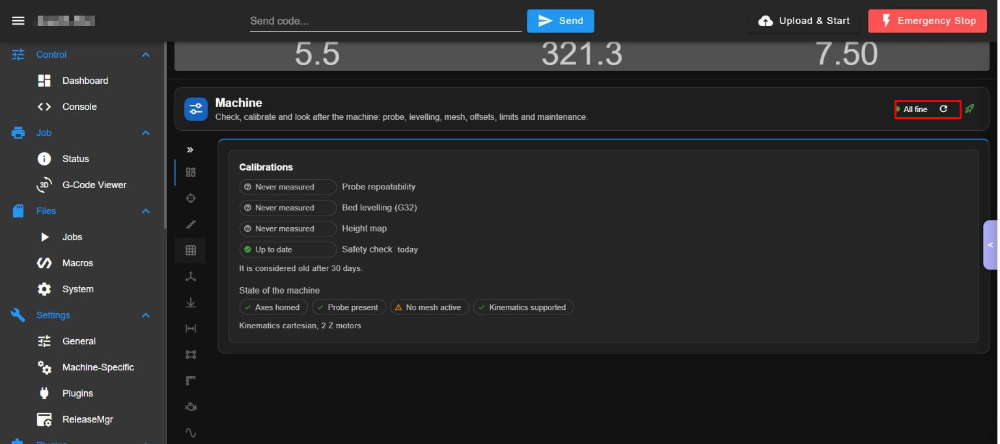

Picture 1: "Calibrations" chips and "State of the machine" chips; the red rectangle marks the refresh icon.

#### Calibrations (how old each result is)
- What: one chip per calibration (Probe repeatability, Bed levelling (G32), Height map, Safety check): "Never measured" or "Up to date" (with the date). A result is considered old after 30 days.
- Where: card "Calibrations" (picture 1).
- How: read it; use the matching entry of the side bar to repeat one.

#### State of the machine
- What: chips for Axes homed, Probe present, mesh active (a warning when none), Kinematics supported, with the kinematics (cartesian, 2 Z motors).
- Where: card under "Calibrations" (picture 1).
- How: read only.

### Probe

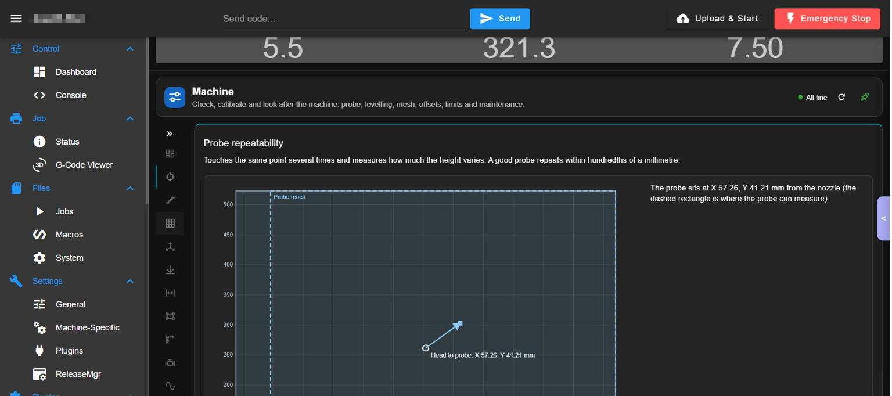

Picture 2: the probe page: a bed map with the probe offset from the nozzle and the reach rectangle.

#### Probe repeatability: bed map
- What: the page touches the same point several times and measures how much the height varies; a good probe repeats within hundredths of a millimetre. The map shows the head position and the probe reach (dashed rectangle), with the probe offset from the nozzle (here X 57.26, Y 41.21 mm).
- Where: Probe, top (picture 2).
- How: read it before starting.

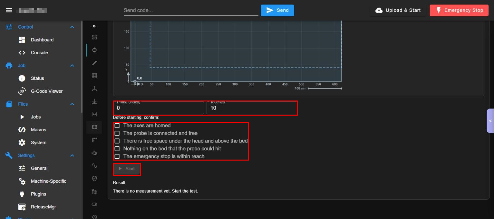

Picture 3: the fields "Probe (index)" and "Touches", the safety checklist and the Start button (red rectangles).

#### Probe index and touches
- What: which probe to use (default 0) and how many touches (default 10).
- Where: two fields under the map (picture 3, top).
- How: type the numbers.

#### Safety checklist and Start
- What: five boxes you must tick before the Start button works: the axes are homed, the probe is connected and free, free space under the head and above the bed, nothing on the bed that the probe could hit, the emergency stop is within reach. Then "Start" runs the test and the Result shows the spread.
- Where: picture 3, checklist and "Start" (grey until all is ticked).
- How: 1. Home the axes first. 2. Tick the five boxes. 3. Press "Start" and stay next to the machine.
- Watch out: the test MOVES the machine and touches the bed.

### Levelling

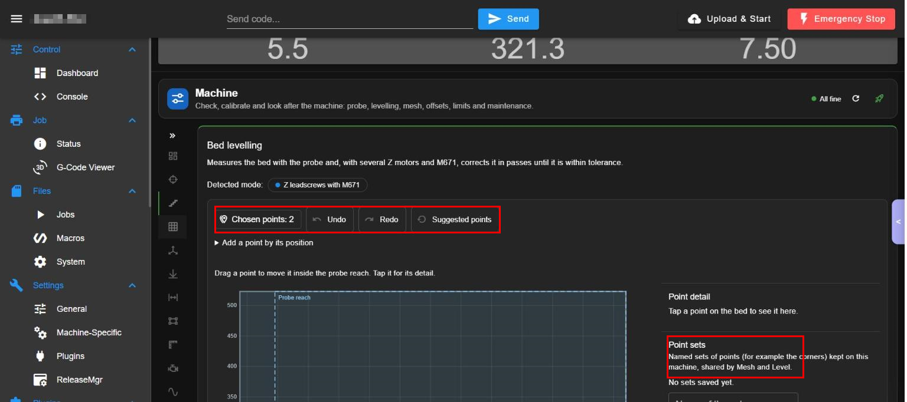

Picture 4: "Bed levelling" with the detected mode, the point tools and the bed map.

#### Levelling points: Undo, Redo, Suggested points
- What: measures the bed with the probe and, with several Z motors and M671, corrects it in passes until it is within tolerance. You choose the points: "Undo", "Redo", "Suggested points" and "Add a point by its position"; drag a point to move it inside the probe reach and tap it for its detail.
- Where: Levelling, toolbar above the map (red rectangle, picture 4).
- How: 1. Check the detected mode ("Z leadscrews with M671"). 2. Adjust the points. 3. Tick the same checklist as the probe and start the levelling.
- Watch out: the run moves axes and the Z motors; not started.

#### Point sets
- What: named sets of points (for example the corners) kept on this machine and shared with Mesh.
- Where: right of the map, "Point sets" (red rectangle, picture 4).
- How: type a name and save the points; load a set later.

### Mesh

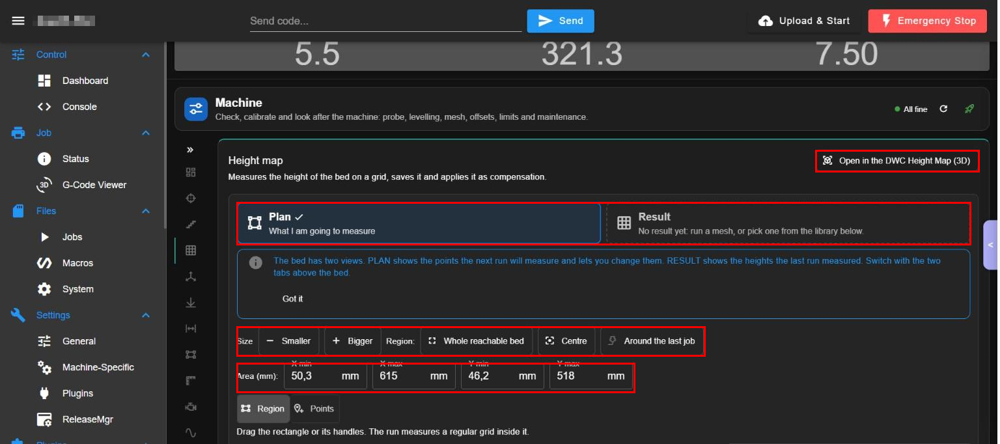

Picture 5: "Height map": Plan and Result tabs, Size and Region buttons, the area fields and "Open in the DWC Height Map (3D)" (red rectangles).

#### Plan and Result views
- What: PLAN shows the points the next run will measure and lets you change them; RESULT shows the heights the last run measured (empty until a mesh runs or you pick one from the library). A blue notice explains this once ("Got it").
- Where: two big buttons at the top of Mesh (red rectangle, picture 5).
- How: press Plan or Result.

#### Size, Region and Area
- What: "Smaller" / "Bigger" change the grid density; the region buttons choose "Whole reachable bed", "Centre" or "Around the last job"; the fields X min, X max, Y min, Y max (mm) set the area by hand.
- Where: rows under the notice (red rectangle, picture 5).
- How: press a button or type the area.

#### Region or Points mode
- What: "Region": drag the rectangle or its handles and the run measures a regular grid inside it. "Points": tap the bed to add individual points.
- Where: buttons under the area fields (picture 5).
- How: press one and edit the bed map below.

#### Open in the DWC Height Map (3D)
- What: opens the standard DWC "Height Map" page to see the mesh in 3D.
- Where: top right of Mesh (red rectangle, picture 5).
- How: press it.

#### Run the mesh, tolerance and taper
- What: lower on the page: "Point detail", the tolerance (cells off the average get a dashed border), the taper height (0 = same compensation at every height), the safety checklist and the run button; the result is saved and applied as compensation; the library lists saved meshes.
- Where: scroll down in Mesh (not in the pictures).
- How: 1. Choose plan and area. 2. Tick the checklist. 3. Start the run.
- Watch out: the run moves the machine and probes; not started.

### Offsets and Height

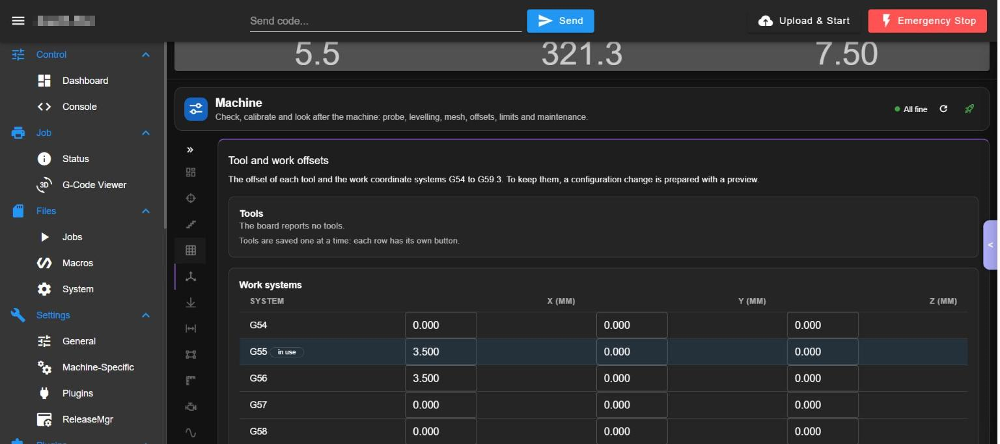

Picture 6: "Tool and work offsets": Tools and "Work systems" G54 to G59.3.

#### Tool offsets
- What: the offset of each tool. Here "The board reports no tools". Tools are saved one at a time: each row has its own button.
- Where: card "Tools" (picture 6).

#### Work coordinate systems G54 to G59.3
- What: the X, Y and Z offset of each work system (G55 is "in use"). Saving writes a `G10` block to the configuration with a preview and a backup, because the board keeps offsets only in memory.
- Where: card "Work systems" (picture 6).
- How: 1. Type the offsets. 2. Press the review/save button of the card and read the preview. 3. Apply.
- Watch out: a wrong work offset shifts every job.

#### Pointer alignment helper
- What: aligns the laser pointer with the laser.
- Where: lower in Offsets (not in the picture).

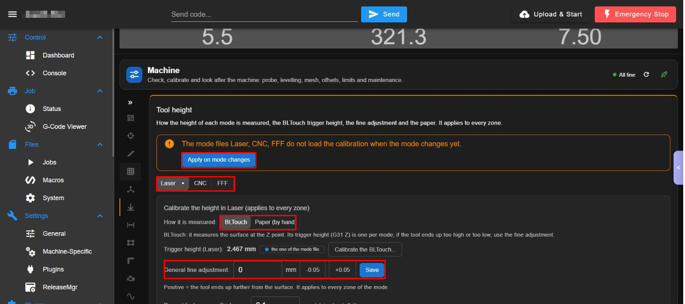

Picture 7: "Tool height": the notice with "Apply on mode changes", the mode tabs, the height method and the fine adjustment (red rectangles).

#### Apply on mode changes
- What: the orange notice says the mode files Laser, CNC and FFF do not load the calibration when the mode changes yet; the button "Apply on mode changes" makes them load it.
- Where: top of Height (red rectangle, picture 7).
- How: press it once.
- Watch out: it edits the mode files.

#### Height per mode and how it is measured
- What: tabs Laser / CNC / FFF choose the mode; "How it is measured" chooses BLTouch or Paper (by hand); the trigger height (here 2.467 mm) is one per mode; "Calibrate the BLTouch..." opens its guide.
- Where: picture 7, below the notice.
- How: choose the mode and the method.

#### General fine adjustment
- What: a value in mm (buttons -0.05 and +0.05, then "Save"): positive means the tool ends up further from the surface; it applies to every zone of the mode. Lower on the page: the paper thickness (default 0.1) for the paper method.
- Where: picture 7, row "General fine adjustment".
- How: 1. Use -0.05 / +0.05 or type the value. 2. Press "Save".
- Watch out: it changes where the tool stops over the surface (laser focus or tool height):

### Limits

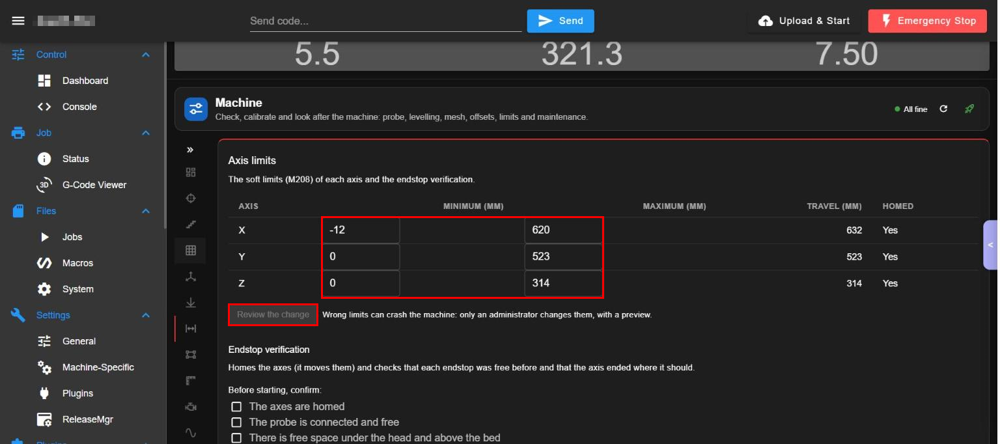

Picture 8: "Axis limits" (M208) and "Endstop verification" (red rectangles).

#### Software limits (M208)
- What: minimum, maximum, travel and "Homed" per axis; "Review the change" prepares a preview of the new limits.
- Where: Limits, table (red rectangle, picture 8).
- How: 1. Type the new minimum or maximum. 2. Press "Review the change". 3. Read the preview and confirm.
- Watch out: only an administrator changes them; wrong limits can crash the machine.

#### Endstop verification
- What: homes the axes (it moves them) and checks that each endstop was free before and the axis ended where expected, with the same checklist as the probe.
- Where: lower part of Limits (picture 8, bottom).
- How: 1. Tick the checklist. 2. Start the verification and stay next to the machine.
- Watch out: it moves the machine; not started.

### Work area

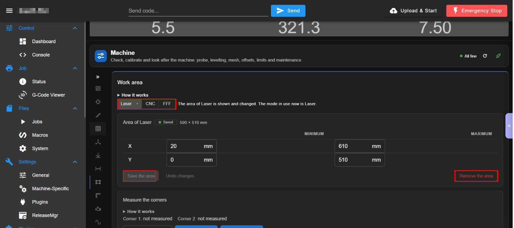

Picture 9: "Work area" with the mode tabs, the area fields and "Save the area" (red rectangles).

#### Work area per mode
- What: the part of the bed where the tool or pointer can work in each mode (Workbench draws it; the laser editor will not save an origin outside it). Tabs Laser / CNC / FFF; X and Y minimum and maximum; the size is shown (590 x 510 mm).
- Where: card "Area of Laser" (picture 9).
- How: 1. Choose the mode. 2. Type the limits. 3. Press "Save the area" (or "Undo changes").
- Watch out: "Remove the area" deletes it.

#### Measure the corners and frame
- What: two opposite corners measured by hand (release the motors, move the pointer, measure against the end stops) and a "frame" that traces the outline with the laser off.
- Where: card "Measure the corners" under the area (scroll down).
- How: follow "How it works"; the frame moves the machine.
- Watch out: "frame" moves the head; not run.

### Calibration

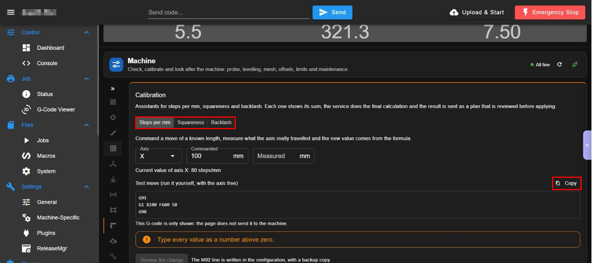

Picture 10: the assistants Steps per mm, Squareness and Backlash (red rectangle) and the copyable test move.

#### Steps per mm
- What: command a move of a known length, measure what the axis really travelled and the new value comes from the formula; the current value is shown (X: 80 steps/mm). The page shows the test G-code (`G91`, `G1 X100 F600 S0`, `G90`) with a "Copy" button; it does NOT send it: you run it yourself with the axis free.
- Where: Calibration > "Steps per mm" (picture 10).
- How: 1. Choose the axis and the commanded length. 2. Copy the test move and run it yourself. 3. Type the measured length. 4. Press "Review the change" (the M92 line is written in the configuration with a backup).
- Watch out: type every value as a number above zero.

#### Squareness and Backlash
- What: assistants for squareness (M556) and backlash with the same flow: the result is sent as a plan that you review before applying.
- Where: tabs "Squareness" and "Backlash" (red rectangle, picture 10).
- How: press the tab and follow the steps.

### Motion

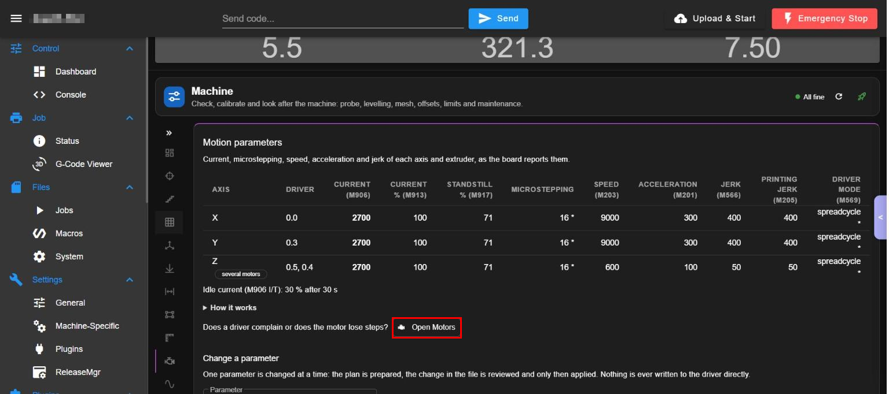

Picture 11: "Motion parameters" as the board reports them.

#### Motion parameters table
- What: per axis: driver, current (M906), current % (M913), standstill % (M917), microstepping, speed (M203), acceleration (M201), jerk (M566), printing jerk (M205) and driver mode (M569); the idle current line.
- Where: Motion, top (picture 11).
- How: read only.

#### Open Motors
- What: a button that opens the Motors page when a driver complains or a motor loses steps.
- Where: under the table (red rectangle, picture 11).
- How: press it.

#### Change a parameter
- What: one parameter at a time: the plan is prepared, the change in the file is reviewed and only then applied. Nothing is written to the driver directly.
- Where: card "Change a parameter" under the table (scroll down).
- How: 1. Choose the parameter and the axis. 2. Type the value. 3. Review the plan. 4. Apply.
- Watch out: administrator only; wrong values can stall or overheat the motors.

### Input shaping

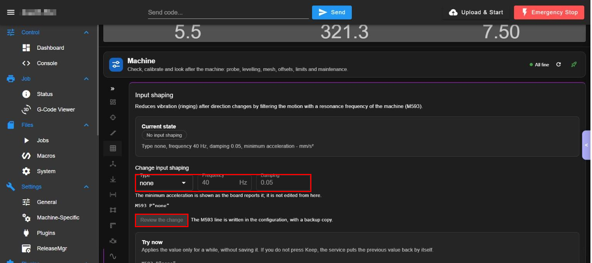

Picture 12: "Input shaping" (M593).

#### Current state and Change input shaping
- What: shows the current shaper (type none, 40 Hz, damping 0.05); the fields Type, Frequency and Damping prepare a new M593 line. The minimum acceleration is shown, not edited.
- Where: Input shaping, cards "Current state" and "Change input shaping" (picture 12).
- How: 1. Choose the type, frequency and damping. 2. Press "Review the change" (the M593 line is written in the configuration with a backup).

#### Try now
- What: applies the value only for a while without saving it; if you do not press "Keep" the service puts the previous value back by itself.
- Where: card "Try now" (picture 12, bottom).
- How: press Try, test, then press Keep or let it revert.
- Watch out: it changes motion for a while.

#### Accelerometer data and ringing test
- What: collection of accelerometer data and a ringing test G-code that you copy and run yourself.
- Where: lower in Input shaping (scroll down).

### Safety check

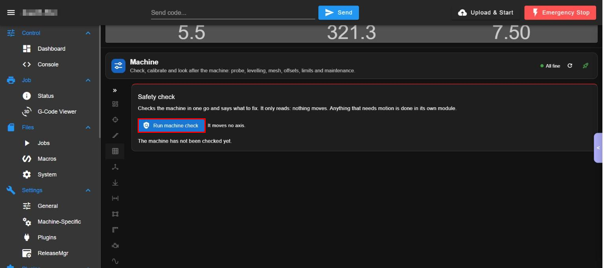

Picture 13: "Safety check" with "Run machine check" (red rectangle).

#### Run machine check
- What: checks the machine in one go and says what to fix. It only reads: it moves no axis and anything that needs motion is done in its own module.
- Where: Safety check (red rectangle, picture 13).
- How: press "Run machine check" and read the list.
- Watch out: it records an entry in the history.

### Maintenance

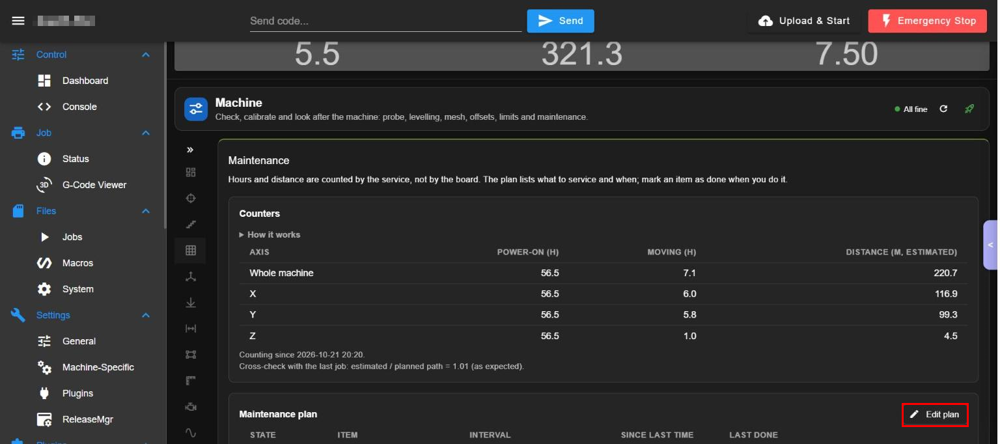

Picture 14: counters and the maintenance plan.

#### Counters
- What: power-on hours, moving hours and estimated distance in metres for the whole machine and per axis, counted by the service (not by the board) since the install date; a cross-check with the last job (estimated / planned path).
- Where: card "Counters" (picture 14).
- How: read it; "How it works" unfolds the explanation.

#### Maintenance plan, Done and Edit plan
- What: the list of what to service and when: state, item, interval, since last time and last done (for example lubricate the Z lead screws every 100 h powered). "Done" marks an item done; "Edit plan" edits the list.
- Where: card "Maintenance plan" (red rectangle on "Edit plan", picture 14).
- How: 1. Press "Done" on an item when you did it. 2. Press "Edit plan" to add, change or remove items.
- Watch out: "Done" resets the counter of the item.

### Machine modes

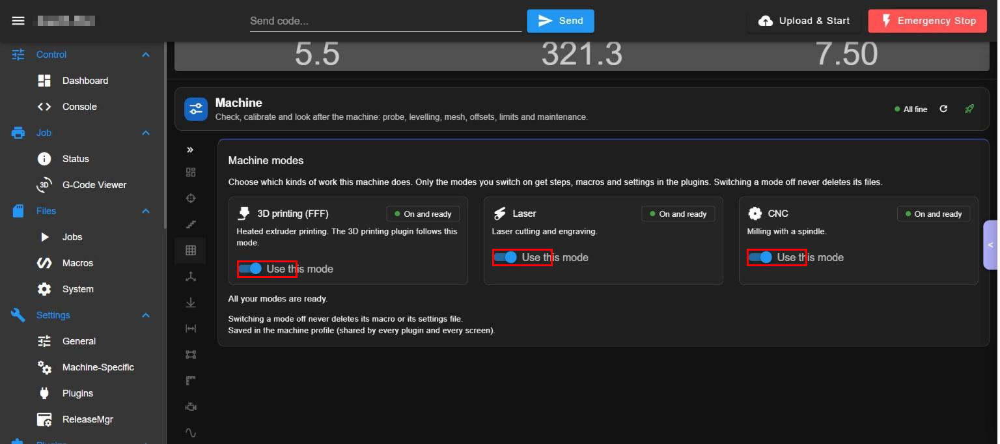

Picture 15: the three mode switches (red rectangles).

#### Use this mode (3D printing, Laser, CNC)
- What: choose which kinds of work the machine does. Only the modes you switch on get steps, macros and settings in the plugins; each shows "On and ready" when its files exist. Switching a mode off never deletes its files. Stored in the machine profile, shared by every plugin and screen.
- Where: Machine modes, three cards (picture 15).
- How: press the switch of a mode.
- Watch out: it changes what every plugin shows.

### History

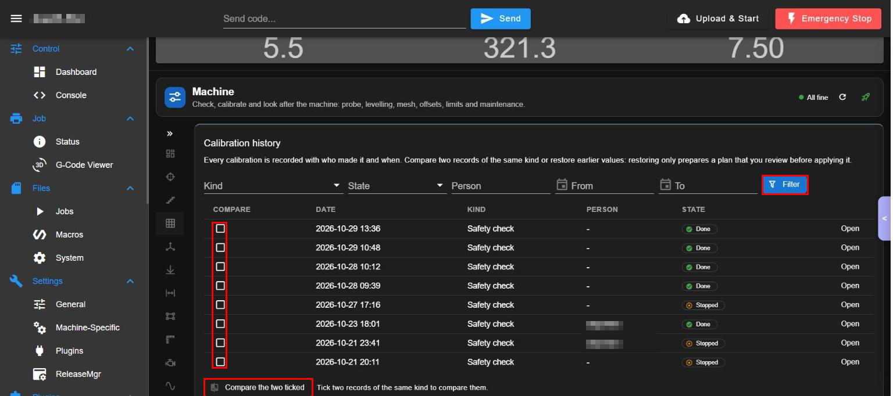

Picture 16: "Calibration history" with the filters, the table and "Compare the two ticked" (red rectangles; the person column is blurred).

#### Filter the history
- What: Kind, State, Person, From and To, then "Filter".
- Where: top of History (red rectangle, picture 16).

#### Records, Open and Compare
- What: every calibration is recorded with who and when; "Open" shows a record; tick two records of the same kind and press "Compare the two ticked" to compare them; restoring earlier values only prepares a plan that you review before applying.
- Where: table and bottom button (red rectangles, picture 16).
- How: 1. Tick two records. 2. Press "Compare the two ticked".

### Report

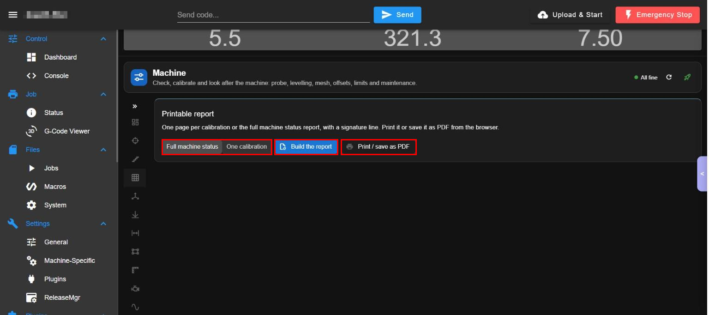

Picture 17: "Printable report".

#### Build and print the report
- What: one page per calibration or the full machine status report with a signature line. Choose "Full machine status" or "One calibration", press "Build the report", then "Print / save as PDF" and use the browser.
- Where: Report (red rectangles, picture 17).
- How: 1. Choose the type. 2. Press "Build the report". 3. Press "Print / save as PDF".
- Watch out: it opens the browser print dialog; cancel it if you do not want to print.

## 4. Settings

| Setting | Meaning | Default | If wrong |
|---|---|---|---|
| Probe index, touches | Which probe and how many taps | 0, 10 | Wrong index measures nothing or the wrong sensor |
| Mesh area, spacing, tolerance, taper | Where and how densely the bed is measured | region of the reachable bed | An area outside the probe reach is clipped or rejected |
| Software limits M208 | Travel allowed per axis | from config.g | Too large: crashes; too small: cannot reach the bed |
| Maintenance plan | Tasks and intervals | built-in list | Reminders lose meaning |
| Modes | Which modes the machine uses | all three active | A mode off hides its pages |

## 5. Roles

Looking is for every role. Running procedures needs Operator or higher; limits and motion parameters need Administrator; every configuration write needs a plan, a preview and creates a backup (`machine_config` plan/apply). Without users everybody is admin.

## 6. API operations used

`machine.*` family (probe, level, mesh, history, offsets, limits, motion tuning, maintenance, config plan/apply `machine.config.apply`, `machine.try`, `machine.mark_cross`), `workarea.release`, `profile.get/set`, `capabilities.get`, `preflight.run`. Closed G-code allow-list in the service (`machine_gcode.py`). Reference: `WorkshopService/docs/api/README.md`.

## 7. Troubleshooting

1. "Axes not homed": home the axes from DWC first.
2. "No mesh active": run a mesh or load one; not an error.
3. A section says "not supported": the kinematics or board capability is missing (see `capabilities.get`).
4. Plan conflict ("a SD file changed"): read the three-column table and continue only if you accept the current state.
5. A stop in a procedure ends at the current step; it is not the emergency stop.

<!-- permissions:start -->

## Permissions and what it changes

Risk: **Medium-high (moves the machine, fires a low-power laser for the offsets)**. Read this before installing; the full document is `security.md` of the Workshop plugins.

**DSF permissions:** none. It is a page of DWC (it runs in your browser) and everything it does goes through the API of `WorkshopService`, which applies the roles (viewer, operator, technician, administrator) in the server.

**Depends on:** `WorkshopService` (install it first, uninstall it last).

**Files it writes:**
- `0:/sys/workshop/config/machine.json` (the machine profile, with a `.bak`)
- calibration records and maintenance counters (`machine-calibration`, `machine-maintenance` in the settings store)
- `config.g`, `bed.g` and the probe offset only through a plan with preview, a snapshot and a `.bak-<stamp>` copy

**Safety notes:**
- Only a closed list of G-code kinds can be tried or written (`machine_gcode.py`); every trial reverts by itself after its time.

Uninstalling removes the plugin folder; your data in `0:/sys/workshop/` and `/opt/dsf/conf/workshop-*.json` stays.

<!-- permissions:end -->

## 8. Limits

Duet 3 + Pi; straight-axis kinematics (Cartesian, CoreXY and variants); the camera verification depends on a Vision measure operation that does not exist yet; real answers of G30/G32/G29/M671 are still partly simulated in tests.

